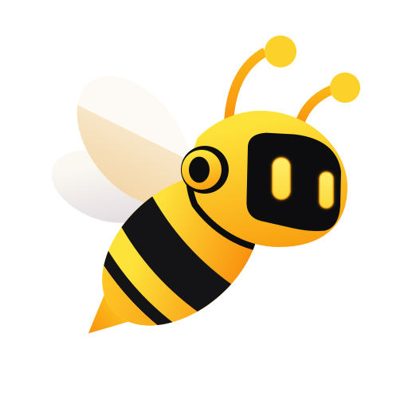

<p align="center">
  
</p>

<h1 align="center">bee</h1>

<p align="center"><strong>A minimal, headless Rust agent runtime implementing ACPv2.</strong></p>

<p align="center">
  <a href="https://github.com/noirbizarre/bee/actions/workflows/ci.yaml">
    
  </a>
  <a href="https://codecov.io/gh/noirbizarre/bee">
    
  </a>
  
  <a href="https://noirbizarre.github.io/bee/">
    
  </a>
  
</p>

---

<!-- One paragraph: what this does and why it exists. Lead with the problem, -->
<!-- not the implementation. -->

## Installation

```bash
brew install noirbizarre/homebrew-tap/bee
```

```bash
paru -S bee-agent  # or your AUR helper of choice
```

Or download a binary for your platform from the
[latest release](https://github.com/noirbizarre/bee/releases/latest).

## Usage

```bash
bee --help
```

## Documentation

<https://noirbizarre.github.io/bee/>

## Contributing

See [CONTRIBUTING.md](CONTRIBUTING.md).

## License

MIT — see [LICENSE](LICENSE).
